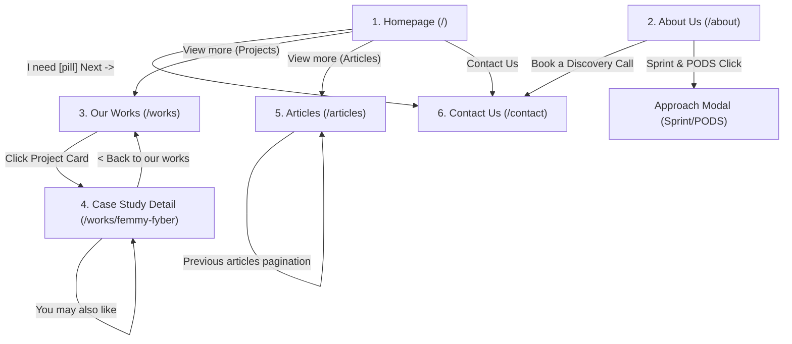

# Buah Pikiran Website — Comprehensive Wireframe & UX Specification

> **Project:** Buah Pikiran Digital Agency Website  
> **Tech Stack:** React + Vite  
> **Mode:** Low-Fidelity Interactive Wireframe & Structural Prototype  
> **Status:** Phase 1 — Wireframe & UX Architecture  

---

## 1. Executive Summary & Brand Identity

**Buah Pikiran** ("Fruit of Thought") is an independent digital agency based in Jakarta, Indonesia, founded in 2019. The agency partners with prominent national and international brands (such as Starbucks, CPPrima Seafood, SOYJOY, ISMAYA, TikTok GO, Bumame, Physiogel, Alva, Komix, Femmy Fyber, etc.) across two primary pillars: **Demand** and **Discovery**.

### Visual & Wireframe Concept
In this wireframe stage, the layout emphasizes:
- **Clean structural hierarchy:** Wireframe block containers, placeholder media with aspect ratios and diagonal crosshairs, clear typographic scale, and intuitive spacing.
- **Functional interactive wireframe elements:** Interactive tabs, modal overlays, animated counters, smooth marquees, and form state management.
- **Client Annotation Layer:** Explicit visual badges corresponding to the client's red handwritten notes in the source design document, allowing designers, developers, and clients to verify UX logic before proceeding to high-fidelity UI design.

---

## 2. Information Architecture & Site Map

---

## 3. Comprehensive Page-by-Page Specifications

### Page 1: Homepage (`/`)

#### 1. Header & Navigation
- **Styling:** Floating peach/pink rounded container (`#FFCCD2`, `border-radius: 9999px`) matching the design document.
- **Logo:** `Buah Pikiran` brand mark with mascot icon.
- **Menu Links:**
  - `About Us` (`/about`)
  - `Our Works` (`/works`)
  - `Articles` (`/articles`)
  - `Contact` (`/contact`)

#### 2. Hero Section
- **Heading:** "Hello! We Are Buah Pikiran"
- **Illustration/Media:** Mascot character (peach warrior with sword & shield).
- **Subcopy:** "Independent digital 🍑 agency based in Indonesia since 2019. We partner with local and international brands and institutions to build their brand, digital presence and campaigns."

#### 3. "What we do?" (Services Showcase)
- **Layout:** Two-column split layout.
  - **Left Column:** Hot pink/coral rounded showcase container (`#FF5E7E`, `border-radius: 24px`) with yellow circular prev/next navigation arrows (`<` `>`). Displays visual preview for the active service.
  - **Right Column:**
    - Category Title: "What we do? — Performance"
    - Service Accordion Items:
      1. `Writing Content`
      2. `Paid Ads`
      3. `Customer Message`
- **Interaction Logic:**
  - Before click: Shows only the service title.
  - After click: Smoothly expands to reveal a 1-2 sentence description and updates the left media preview.

#### 4. Service Inquiry Selector ("I need ... Next ->")
- **Layout:** Contained within a soft peach/pink rounded box (`#FFF0F2`, `border: 2px dashed #FFB8C2`, `border-radius: 32px`).
- **Vertical Drum Picker:** The options are arranged vertically (`360° Campaign`, `Branding`, `Web design`, `SEO`, `KOL`, `Strategic communication`, `Marketing strategy`).
- **Interaction Logic:**
  - Scrolled vertically by clicking the items above or below (not by mouse wheel scroll).
  - Clicking any visible item above or below smoothly shifts that item to the active centered position (highlighted in bright yellow `#FFC000`).
  - Clicking "Next →" (yellow pill button) navigates to `/contact?service=<selected_service>`, pre-populating the dropdown on the Contact page.

#### 5. Brands Marquee ("Brands we've worked with")
- **Client Reference:** `https://madebyhart.com/`
- **Interaction Logic (Client Annotation):**
  - "Interaktif logo bergerak"
  - Continuous horizontal infinite marquee ticker containing partner logos (Starbucks, CPPrima Seafood, Soyjoy, Algonova, Ismaya, TikTok GO, Bumame, Physiogel, Alva).
  - Pauses or slows smoothly on user hover.

#### 6. Testimonials ("What They Say About Buah Pikiran")
- **Rating:** 5 peach rating icons (`🍑🍑🍑🍑🍑`).
- **Layout:** Testimonial quote on left, client media/photo on right.
- **Content:**
  - Quote: *"Buah Pikiran is one of our partners that opens new perspectives and insights on digital strategies. We appreciate its responsiveness for every tasks and discussions in building PLN's digital presence. Cheers!"*
  - Name: Joshia Pardede
  - Role: Corporate Social & Digital Media Officer PT PLN (Persero)
- **Interaction Logic (Client Annotation):**
  - "Animasi Flip Book"
  - Next/Previous button controls toggle between testimonials with a card slide or flip animation.

#### 7. Read the Juicy Articles (Blog Teaser)
- **Header:** "Read the Juicy Articles"
- **Cards (3 Columns):**
  1. *Zero-Click Searches Are Rising: How to Keep Your Website Traffic Alive Today* (Tag: SEO & AI Search | 16 Nov 2026 | 8 mins)
  2. *How Google’s AI Overviews Are Quietly Reshaping Your Organic Click-Through Rates* (Tag: SEO & AI Search | 16 Nov 2026 | 5 mins)
  3. *The Hidden Cost of Inconsistent Messaging Across Your Website and Social Media* (Tag: Branding & Positioning | 16 Nov 2026 | 3 mins)
- **Action:** "View more" button linking to `/articles`.

#### 8. Recent Project (Case Studies Teaser)
- **Header & Intro:** "Recent Project" with description paragraph and "View more" button linking to `/works`.
- **Featured Cards:**
  1. *FEMMY FYBER* (Featured | May 2026) -> links to `/works/femmy-fyber`
  2. *KOMIX* (Featured | Mar 2026)
  3. *FLYJAYA* (Featured | Dec 2025)

#### 9. Global Footer
- Direct contact prompt: "Drop us hello at: hello@buahpikiran.id" with friendly mascot.
- Company info: `buahpikiran.id`, Menara Sentraya Lt-10 Unit A6, Jl. Iskandarsyah Raya No. 1A Melawai, Kebayoran Baru, Jakarta Selatan.
- Social links: Instagram, LinkedIn, TikTok.
- Sitemap navigation links: `HOMEPAGE`, `ABOUT`, `OUR WORKS`, `CONTACT`.
- Copyright & Back to top button (`↑`).

---

### Page 2: About Us (`/about`)

#### 1. Hero Section
- Title: "About Us"
- Headline: "Started in 2019, Buah Pikiran build its culture and value to reach global market"
- Mascot illustration (researcher with blueprints and lenses).

#### 2. Our Values (4 Cards)
1. **Boldness**: "Shows boldness in their actions in the role that they’re in."
2. **Integrity**: "Shows honesty in their intentions & actions in the role that they’re in."
3. **Teamwork**: "Communicate clearly their problems/solutions so the team can move forward effectively"
4. **Effectiveness**: "Do work that shows effective results in the role that they’re in"

#### 3. Meet the Founders
- 3 Founder Profiles:
  1. **Suharto Rizkiadi** — Chief Executive Officer
  2. **Kartika Eprilla** — Chief Operating Officer
  3. **Nurul Imania** — Chief Growth Officer
- **Interaction Logic (Client Annotation):**
  - *Annotation:* "Core Expertise ini kalau baru muncul setelah icon foto di hover apakah possible? Biar ngga terlalu banyak info."
  - Default view displays clean profile (avatar, name, designation).
  - Hovering over a card or photo reveals an animated "Core Expertise & Focus Area" drawer:
    - *Suharto Rizkiadi:* Business Strategy & Client Development, Cross-Client Collaboration, Team Building & Culture Amplification.
    - *Kartika Eprilla:* 360 Marketing Strategy, Digital Content Marketing, The Framework & Standart Enforcer.
    - *Nurul Imania:* Growth Strategy & Digital Transformation, Cross-Channel Campaign Optimization, Startup & Scale-Up Brand Acceleration.

#### 4. Our Signature Approach (Sprint & PODS)
- Two signature methodology cards:
  - **Sprint**
  - **PODS**
- **Interaction Logic (Client Annotation):**
  - *Annotation:* "Button SPRINT & PODS pop up -> Animation GIF / description modal."
  - Clicking either button triggers a modal dialog presenting the methodology, breakdown, timeline, and deliverables.

#### 5. CTA Section
- "Start your project with us!" with mascot team.
- CTA Button: "Book a Discovery Call" -> navigates to `/contact`.

---

### Page 3: Contact Us (`/contact`)

#### 1. Hero Header
- Mascot fruits row (apples, peaches, bananas).
- "Drop us hello at: hello@buahpikiran.id"
- "OR, LET US CONTACT YOU"

#### 2. Inquiry Type Selector
- Radio buttons:
  - `(•) I have a project`
  - `( ) I can refer you to a potential client`
  - `( ) I want to be part of your team`

#### 3. Services Dropdown / Picker
- Dropdown with multi-category options:
  - Digital PR, SEO, Content, Client Services, Creative Studio, Data, People, Resources, Social Media, Paid Ads, AOE Search.
- **Interaction Logic (Client Annotation):**
  - *Annotation:* "Choose services bisa turun kebawah & di pick. Kalau base color pink ngga possible, warna abu abu default juga gapapa :D"
  - Custom dropdown styling with clean focus states and support for pre-selection via URL parameters (from Homepage "I need" selector).

#### 4. Form Fields
- `Your name*` (First Name, Last Name)
- `Your email*`
- `Message (optional)`
- `Send` button with submission feedback state.

---

### Page 4: Our Works (`/works`)

#### 1. Header & Value Proposition
- Title: "The problem we 🍑 solved"
- Statement: "Clients globally come to us with either one of these problems: Demand or Discovery. We drive search demand or discovery for brands with ambitions to be category leaders."

#### 2. Category Filter Bar
- Filters: `All`, `Demand`, `Discovery`, `KOL`, `Branding`, `SEO`, `Website`, `Social Media`.

#### 3. Case Studies Grid
- **FEMMY FYBER** (KOL, 2026) -> links to `/works/femmy-fyber`
- **KOMIX** (Branding, 2026)
- **FLYJAYA** (SEO, 2026)
- **PHYSIOGEL** (Social Media, 2026)
- **LAMPAG** (Website, 2026)
- Wireframe placeholder slots for upcoming case studies.

---

### Page 5: Case Study Detail (`/works/femmy-fyber`)

#### 1. Header & Navigation
- Back button: `← Back to our works`

#### 2. Hero & Project Metadata
- Project Banner media container.
- Metadata Card:
  - Tags: `KOL` | `2026`
  - Title: **FEMMY FYBER**
  - Project Info: Client background and engagement scope.

#### 3. Challenge & Objective
- **Objective:** "Launching Dojo in B2B UK market to half a bill £ revenue business in 5 years"
- **The Challenge:** Complete narrative outlining organic non-brand growth, industry-leading SEO and Digital PR requirements.

#### 4. Impact Metrics (Rolling Numbers Animation)
- **Interaction Logic (Client Annotation):**
  - *Annotation:* "Animasi rolling numbers"
  - Animated number counters count up when scrolled into view:
    - **155%** — Increase in monthly brand traffic
    - **1.9K** — Keywords pos 1-3
    - **235+** — Link clicks directly into sales
    - **140K** — Increase buyer in the marketplace in a month

#### 5. Campaign Showcase & Gallery
- Section: "What we did? The Rise team on London streets showing just how much presence Dojo now has on the highstreet"
- 6-slot responsive gallery grid showcasing creative assets.

#### 6. Related Works ("You may also like")
- Two related project cards:
  - **KOMIX** (KOL, 2026)
  - **FLYJAYA** (SEO, 2026)

---

### Page 6: Articles / Blog (`/articles`)

#### 1. Hero Section
- Title: "Enjoy the 🍑 Juicy Articles"
- Intro description and reading guide.

#### 2. Recent Articles Grid
- 6 Grid Cards featuring recent pieces with tags (`SEO & AI Search`, `Branding & Positioning`), publish dates, read duration, and title.

#### 3. Previous Articles Section (Filtered & Paginated)
- Filter dropdowns: `Year ▾` (e.g., 2026, 2025, 2024) and `Month ▾` (All, Jan - Dec).
- Pagination: `< 1 2 3 4 5 >`
- **Interaction Logic (Client Annotation):**
  - *Annotation:* "ini list untuk bagian previous articles aja, jadi bagian recent articles yang atas ga berubah pas ke refresh"
  - The pagination controls and filters are strictly scoped to the `Previous Articles` list; the `Recent Articles` section remains untouched.

---

## 4. Interactive Wireframe Mode & Client Notes Overlay
To make this wireframe immediately testable and informative for stakeholders, the React application includes:
1. **Interactive Routing:** Real-time navigation between all 6 pages with query-parameter state passing (e.g. `Homepage -> Contact`).
2. **Wireframe Annotation Toggle:** A top-level toggle (`[?] Show Design Notes`) that displays the exact client notes from the Figma/PDF document overlaid on each section.
3. **Responsive Blueprint Aesthetics:** Wireframe placeholder boxes with visual aspect ratio tags, crosshatch indicators, and clean typography.
